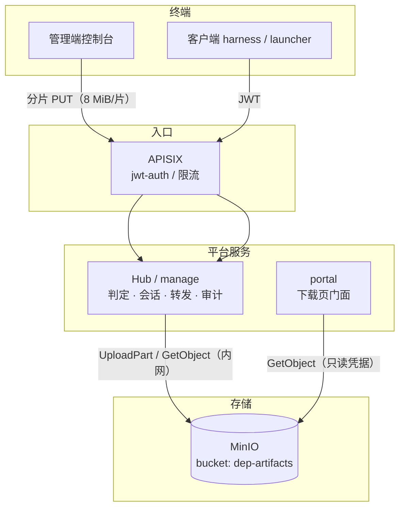
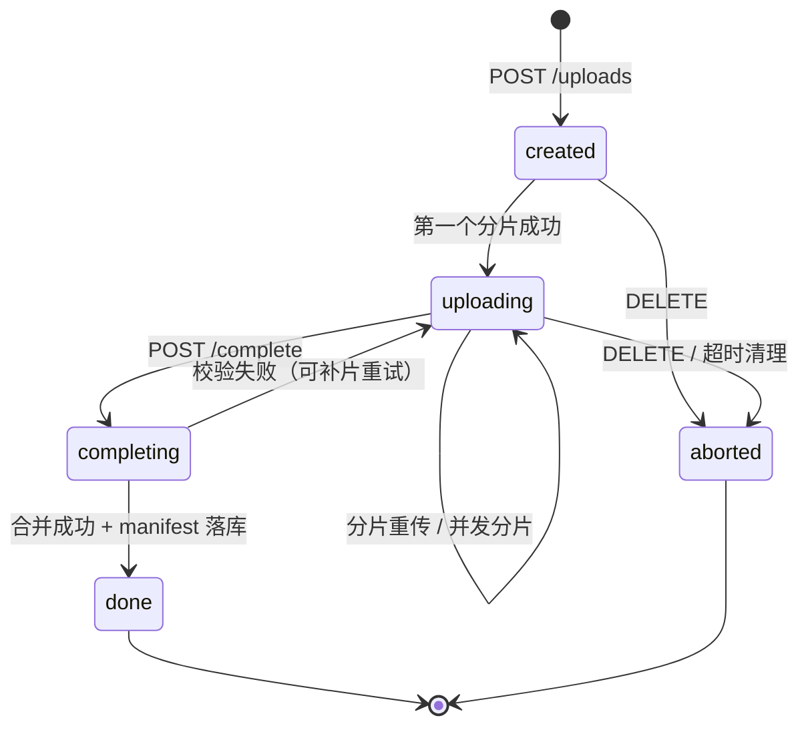
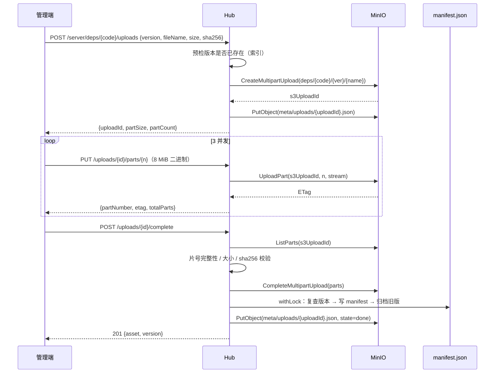

# 依赖库存储方案：MinIO 对象存储 + 分片上传

本分支为 MinIO 改造分支：依赖库的制品、清单、审计全部落 MinIO（S3 协议），
**不保留 Gitea 后端，也不做数据迁移** —— 历史数据随改造一起废弃。

配套接口文档见 `依赖库上传下载API.md`。

---

## 0 结论摘要

| 议题 | 结论 |
| --- | --- |
| 存储后端 | MinIO（S3 兼容），单桶 `dep-artifacts`，四个前缀分区 |
| 分片协议 | S3 Multipart Upload，服务端代理转发；客户端不直连 MinIO |
| 默认分片大小 | 8 MiB，按文件大小自动上浮，片数上限 10000 |
| 元数据（manifest） | 存对象存储 `meta/` 前缀，不进数据库 |
| 会话持久化 | 会话 JSON 写 `meta/uploads/`，断点续传靠 ListParts + 会话记录 |
| sha256 | 逐片校验（默认）+ 完成时全量流式校验（可配） |
| 单文件上限 | 20 GiB（受 10000 片 × partSize 约束） |
| 兼容性 | 旧接口 `POST /server/deps/{code}/versions` 保留，供小文件走单请求 |

一句话：**MinIO 只负责存字节，判定（可见性、启用、版本不可变）仍然全在 Hub。**

---

## 1 为什么放弃 Gitea

### 1.1 旧链路

```
管理端 ──POST /server/deps/{code}/versions（裸流，一次传完）──▶ Hub
                                                              │ 只读管道
                                                              ▼
                                        PUT /api/packages/{org}/generic/{pkg}/{ver}/{file}
                                                              ▼
                                                            Gitea
```

### 1.2 硬伤

| # | 问题 | 表现 |
| --- | --- | --- |
| 1 | generic registry 只有单请求整体 PUT，无 Multipart 语义 | 2 GiB 的 exe 必须一次请求传完 |
| 2 | 无断点续传 | 传到 90% 断网，进度归零重来 |
| 3 | 三处体积上限互相钳制 | Gitea `LIMIT_SIZE_GENERIC`、APISIX `client_max_body_size`、Hub 内存与超时 |
| 4 | 上传期间独占全局写锁 | `store.withLock()` 超时 30 分钟，一个大文件上传期间所有写操作排队 |
| 5 | 单连接吞吐受限 | 家庭宽带上行 2 MB/s 时，2 GiB 需 17 分钟，中途不能抖 |
| 6 | 无法并发分片 | 用不上多连接带宽 |
| 7 | `latest` 镜像不可控 | 一旦变成制品总仓就不能再跟 latest |

第 3、4 条是真正阻塞：即便把上限调到 10 GiB，**中断重传**和**独占锁**也解决不了。

### 1.3 MinIO 补上的

- 原生 Multipart：`CreateMultipartUpload / UploadPart / CompleteMultipartUpload / AbortMultipartUpload / ListParts`。
- 每片 8 MiB，单请求体积远低于任何网关的 body 限制，**不需要再调 APISIX 上限**。
- 片级重传：断在第 137 片，只补第 137 片。
- 片级并发：3 连接并发，带宽能被吃满。
- Complete 时才落成完整对象，半成品不会以「完整文件」形态出现。

---

## 2 范围

### 2.1 本分支做

| 模块 | 改动 |
| --- | --- |
| 依赖库制品字节 | → MinIO 对象，`deps/` 前缀 |
| 依赖库 manifest | → MinIO 对象，`meta/deps/` 前缀 |
| 审计 `audit.json` | → MinIO 对象，`meta/audit.json` |
| 上传接口 | 新增 6 个分片端点，旧端点保留供小文件用 |
| 下载接口 | 路径不变，Range 由 MinIO 原生支持 |
| 前端上传器 | 分片上传 + 断点续传 + 增量 sha256 |
| `portal/` | 只读 MinIO |

### 2.2 不在本仓库范围

**插件库的 npm registry 仍跑在 Gitea 上。** 它用的是 Gitea 的 packument / tarball 两条路径，MinIO 不实现 npm 协议。插件库代码不在本仓库，本次不动它。

> 也就是说：依赖库已经和 Gitea 彻底解耦，但 Gitea 实例本身还活着（给插件库用）。要让它退役需要另立项目换 Verdaccio + MinIO。

### 2.3 不变的部分

- 判定逻辑（可见性、启用状态、版本不可变、审计）仍在 Hub。
- 客户端接口契约（`/client/deps/**`）一个字段都不改。
- 存储文件名压平为 `.dat`（理由见 §4.4）。
- 版本状态机 `unreleased → enabled → taken_down`。

---

## 3 目标架构



三条硬约束：

1. **客户端永不直连 MinIO**。MinIO 只监听内网地址，不出现在任何响应里。
2. **MinIO 只存字节**，可见性、启用、版本判定全在 Hub。
3. **唯一入口不破**，分片也走 `/server/**`，继承网关的 jwt-auth 与限流。

---

## 4 存储布局

### 4.1 桶与前缀

单桶 `dep-artifacts`，四个前缀，靠 bucket policy 隔离读写权限：

| 前缀 | 内容 | 写入方 | 读取方 |
| --- | --- | --- | --- |
| `deps/{code}/{version}/{storageName}` | 制品字节 | manage | manage、portal |
| `meta/deps/{code}/manifest.json` | 资产清单 | manage | manage、portal |
| `meta/deps/{code}/history/{ts}.json` | manifest 历史版本 | manage | manage（回滚用） |
| `meta/uploads/{uploadId}.json` | 分片上传会话 | manage | manage |
| `meta/audit.json` | 审计 | manage | manage |

可选 `MINIO_PREFIX` 在桶内再加一层前缀（多环境共用一个桶时用）。

### 4.2 对象 key 与 manifest 的 `path` 完全一致

`files[0].path = "{code}/{version}/{storageName}"` 就是对象 key，
manifest 不需要为此多存一个字段：

```
"vc-redist/1.4.2/VC_redist.x64.dat"   ← manifest.files[0].path
"vc-redist/1.4.2/VC_redist.x64.dat"   ← 对象 key
```

### 4.3 下载地址

对外 URL 仍是 `/client/deps/{code}/versions/{version}/download`，由 Hub 用
`GetObject(Range)` 流式转发。MinIO 内网 endpoint 不出现在响应里。

### 4.4 为什么保留 `.dat`

`toStorageFileName()` 把真实扩展名压成 `.dat`，两个原因：

1. 前置 WAF / 下载防护会直接重置 `.exe/.msi/.dll/...` 的上传请求（连接被 RST）。
   分片上传已绕开（请求体里没有文件名），但预签名直连场景仍会命中。
2. 直连对象存储时，带 `.exe` 的 key 会让网关/浏览器的下载策略行为不可控。

真实文件名在 manifest 的 `name` 字段，通过 `Content-Disposition` 还原，用户侧无感。

### 4.5 桶初始化

服务启动时 `ensureBucket()` 做两件事，全部幂等：

| 步骤 | 行为 | 失败处理 |
| --- | --- | --- |
| 1. `HeadBucket` | 桶不存在且 `MINIO_AUTO_CREATE_BUCKET=true` → `CreateBucket` | 关闭自动创建时抛 `BucketNotFound`，日志提示手工建桶 |
| 2. 公开策略检测 | 读 bucket policy，发现允许匿名 `s3:GetObject` 就告警 | 只告警，不擅自改别人的策略 |

**建桶时不带任何 ACL / Policy**，S3 与 MinIO 的新桶默认就是私有。

**这里刻意不配生命周期规则。** MinIO 全线不支持 `PutBucketLifecycleConfiguration` 里的
`AbortIncompleteMultipartUpload`（官方 S3 兼容性文档 multipart 章节明确列为差异项），
任何版本都是 400，不是版本高低的问题。中断分片的回收由 MinIO 服务端内建清理负责，
与桶上的 ILM 规则无关，详见 [6.7 过期清理](#67-过期清理)。

### 4.6 私有桶为什么不影响下载

私有桶限制的是**匿名访问**，不是**带凭据的访问**。两条下载链路都是 S3 签名请求：

```
管理页 → GET /client/deps/{code}/versions/{v}/download → Hub GetObject（manage 凭据）
下载页 → 同上 → portal GetObject（只读凭据）
```

浏览器只会看到服务端地址，看不到 `minio:9000/deps/...` 这种直链。
反过来，桶**必须**私有：一旦开了匿名读，知道对象 key 就能绕过启用状态、版本判定和审计直接下载。

---

## 5 元数据

### 5.1 为什么不用 MySQL

manifest 只有几 KB，写入频率极低（一次上传 / 一次启停）。引 MySQL 会把
「无状态服务」变成「有状态服务」，运维面扩大一个数量级，收益（事务）在这个
写频率下几乎用不上。

代价是失去 git 的历史能力，用**写前归档**补上：每次覆盖前把旧版丢进
`meta/deps/{code}/history/`，保留最近 20 版。

### 5.2 并发控制

`DepStore.withLock()` 是进程内串行队列，单实例部署下足够。

多实例部署时（当前不是），把 `withLock` 换成 Redis 分布式锁（`SETNX` + TTL），
其余逻辑不变。

### 5.3 审计

`audit.json` 是单对象、200 条上限、串行 append。

已知缺陷（本次不修）：每追加一条就重写整个 200 条 JSON。P2 可改为
`meta/audit/{yyyy-mm-dd}/{ts}.json` 每日分片、写入变纯 append。

---

## 6 分片上传设计

### 6.1 会话状态机



### 6.2 会话由 Hub 生成，S3 uploadId 不外泄

- 对外 `uploadId`：`up_` + 时间戳 + 16 位 hex，可控、可审计。
- S3 的 `MultipartUploadId` 存在会话 JSON 里，只在服务端流动。
- 客户端拿到的 ID 拼不出任何直连对象存储的请求。

### 6.3 分片大小

```js
const MIN_PART = 8 * 1024 * 1024          // 8 MiB（S3 下限 5 MiB，留余量）
const S3_MIN_PART = 5 * 1024 * 1024        // 硬下限，配错了也不能低于它
const MAX_PARTS = 10000                    // S3 硬上限
const MAX_PART = 5 * 1024 * 1024 * 1024    // 5 GiB

function planParts(size, { minPart = MIN_PART, maxParts = MAX_PARTS, requested = 0 } = {}) {
  const byLimit = Math.ceil(size / MAX_PARTS)
  const floor = Math.max(minPart, S3_MIN_PART)   // ← 关键：防止 DEP_PART_SIZE 配小
  let partSize = Math.max(floor, byLimit, Math.min(requested, 64 * 1024 * 1024))
  partSize = Math.ceil(partSize / (1024 * 1024)) * 1024 * 1024   // 对齐 1 MiB
  if (partSize > MAX_PART) throw new HttpError(413, '文件超过 5 TiB')
  return { partSize, partCount: Math.ceil(size / partSize) }
}
```

**5 MiB 那道下限不能省。** 实测把 `DEP_PART_SIZE` 配成 2 MiB 时，分片能正常传完，
但 `CompleteMultipartUpload` 会被 MinIO 以 `EntityTooSmall` 拒绝 —— 报错出现在
最后一步，前面的分片全白传。已在真实 MinIO（RELEASE.2022-01-04）复现。

实测取值：

| 文件大小 | partSize | 片数 |
| --- | --- | --- |
| 10 MiB | 8 MiB | 2 |
| 500 MiB | 8 MiB | 63 |
| 2 GiB | 8 MiB | 256 |
| 20 GiB | 8 MiB | 2560 |
| 100 GiB | 11 MiB | 9310 |

### 6.4 为什么分片阶段不进写锁

旧实现整个上传周期都持 `withLock`，一次 2 GiB 上传会让所有写操作排队 17 分钟。

新的分工：

| 阶段 | 是否进锁 | 说明 |
| --- | --- | --- |
| 创建会话 | 否 | 只做版本存在性**预检**（可能读到旧索引，允许误放行） |
| 上传分片 | 否 | 完全不碰 manifest |
| 完成并登记 | **是** | 进锁后强制刷新索引、复查版本冲突，再写 manifest |
| 取消 / 过期清理 | 否 | 只删对象，不碰 manifest |

`complete` 里的复查是版本不可变的最终防线：预检和完成之间有人抢先上传了同版本，
这里必须 409 并删掉刚合并的对象。

### 6.5 校验策略

`DEP_VERIFY_MODE` 三档：

| 模式 | 行为 | 成本 | 适用 |
| --- | --- | --- | --- |
| `chunk`（默认） | 每片按 `X-Chunk-Sha256` 校验；整体 sha256 采用客户端声明值并落库 | 0 额外 IO | 常规 |
| `full` | 在 chunk 基础上，Complete 后 `GetObject` 全量流式复算 | 一次全量读 | 硬要求 |
| `none` | 只校验大小 | 0 | 仅调试 |

`full` 的成本：2 GiB 对象在 MinIO 本机回环上约 3~8 秒，走网络盘 20~40 秒。
不建议默认开启 —— 片级校验 + 大小校验已经能覆盖传输损坏，`full` 多挡的只是
「客户端自己算错/被篡改」，内部发布场景不值得每次多读一遍 2 GiB。

### 6.6 断点续传

恢复走两条信息源：

1. 客户端 `localStorage` 记 `uploadId`（键 = code + version + fileName + size）。
2. 服务端 `GET /uploads/{uploadId}` 返回 `ListParts` 结果，客户端据此算缺失片号。

刷新页面、换浏览器都不影响：只要 `uploadId` 还在，就能接着传。

这两个地方都会让「续传」名存实亡，实现时必须盯住：

| 坑 | 表现 | 正确做法 |
| --- | --- | --- |
| 会话前缀查错 | 会话写在 `meta/uploads/`，却去扫 `uploads/`；永远查不到进行中的会话，每次「继续」都新建一个 multipart | 由 `driver.meta.list(prefix)` 统一拼前缀，上层只认逻辑前缀 `uploads/` |
| 用 abort 做暂停 | 中断正在传的分片，而 S3 里**半片无效**；暂停时 3 个并发都没传完就等于全废，继续后从 0 开始 | **软暂停**：只停止调度新分片，等在传的几片写完再进入 paused |

软暂停的实现要点：

- `shouldPause()` 在 worker 循环开头检查，命中就抛 `PausedError`（自定义，不是 `AbortError`）。
- **只留最先完成的那一片**：第一个跑完的 worker 调 `pauseController.abort()`，其余在传的
  立刻中断。不这么做的话 3 个 worker 都卡在 `await putPart`，每个都要等自己那片传完，
  实际等待时间是最慢那片 —— 慢速网络下点暂停要等好几分钟。
- 被中断的 worker 拿到的是 `AbortError`，用 `shouldPause()` 区分「暂停」与「取消」：
  是暂停就转成 `PausedError`，是取消就原样抛出。
- 用 `Promise.allSettled` 而不是 `all`：全部 settle 才是真的停住了。
- 前端按 `PausedError` 进 `paused` 态，不按 `AbortError`；后者只用于「取消」。

代价：最多丢 2 片（16 MiB）已传字节。换来的是「点暂停 1~2 秒内必停」，
比等 3 片快一个数量级，也比「从头再来」划算。

### 6.7 过期清理

两套机制，各管一段：

1. **Hub 侧**：会话 `expiresAt`（默认 24h）。`get` / `list` / `findActive` 命中过期会话时
   惰性 `AbortMultipartUpload` 并删掉 `meta/uploads/{id}.json`。
2. **MinIO 侧**：服务端内建的 stale uploads 清理，兜住 Hub 重启/崩溃留下的孤儿分片。

> **MinIO 侧的清理是服务端行为，不是桶上的 ILM 规则。** 默认把超过 24h 未写入的分片上传
> 清掉（`api stale_uploads_expiry`），每 6h 扫一次（`api stale_uploads_cleanup_interval`），
> 可用 `MINIO_API_STALE_UPLOADS_EXPIRY` / `MINIO_API_STALE_UPLOADS_CLEANUP_INTERVAL` 覆盖。
> 判定依据是 uploadID 目录的最后写入时间，持续有分片落盘的长传输不会被误删。
>
> **不要试图用 `AbortIncompleteMultipartUpload` 接管这件事**：MinIO 全线不支持这个
> lifecycle 动作（官方 S3 兼容性文档 multipart 章节明确列为差异项），任何版本都返回 400。

Hub 侧的惰性清理有个前提：**得有人碰这条会话**。正常链路（续传探测、暂停取消、重复
`complete`）都会触发；但如果客户端传到一半消失，之后既没有人重传同一版本、也没有人调
`GET /server/deps/{code}/uploads`，那条会话 JSON 会一直留着（分片本身仍由 MinIO 在 24h
内回收）。量级是几百字节一个文件，可忽略；要彻底清干净可以再加一层定时清扫。

### 6.8 完整时序



---

## 7 下载

| 项 | 做法 |
| --- | --- |
| Range | `GetObject` 传 `Range`，MinIO 返回 206 + `Content-Range`，Hub 透传 |
| HEAD | `StatObject` 拿 size / etag，返回 `Accept-Ranges: bytes` |
| 校验头 | 继续带 `X-Checksum-Sha256`（来自 manifest，不是 MinIO 的 ETag） |
| 缓存 | `Cache-Control: no-store`（判定要每次过 Hub） |
| 失效兜底 | 对象不存在 → 502 存储异常，不暴露 MinIO 错误细节 |

**ETag 不能当校验和**：分片上传对象的 ETag 形如 `{md5-of-md5s}-{partCount}`，
既不是文件 MD5 也不是 sha256。唯一可信源是 manifest 里的 sha256。

### 预签名直连（P1 可选，默认不做）

省掉 Hub 的双倍流量，代价是 MinIO 地址要暴露给浏览器、鉴权退化为「URL 即凭证」、
「客户端永不直连存储」这条约束被打破。建议只对内部管理端开放，签名有效期 ≤ 10 分钟。

---

## 8 接口清单

| 能力 | 路径 |
| --- | --- |
| 创建会话 | `POST /server/deps/{code}/uploads` |
| 会话列表 | `GET /server/deps/{code}/uploads` |
| 查会话（续传） | `GET /server/deps/{code}/uploads/{uploadId}` |
| 上传分片 | `PUT /server/deps/{code}/uploads/{uploadId}/parts/{n}` |
| 完成 | `POST /server/deps/{code}/uploads/{uploadId}/complete` |
| 取消 | `DELETE /server/deps/{code}/uploads/{uploadId}` |
| 单请求直传（小文件） | `POST /server/deps/{code}/versions` |
| 下载 | `GET /client/deps/{code}/versions/{version}/download` |

报文、错误码、客户端示例见 `依赖库上传下载API.md`。

---

## 9 实现要点

### 9.1 服务端分层

```
routes/deps.js          HTTP：分片路由、Range 转发、错误落状态码
lib/dep/uploads.js      会话：创建/查询/分片/完成/取消/过期
lib/dep/store.js        业务：预检 reserveVersion、登记 commitVersion（唯一持锁点）
lib/dep/storage.js      驱动：对象 key 约定、manifest、制品读写、multipart 封装
lib/storage/s3.js       SDK：S3Client + 12 个命令
lib/audit.js            审计：通过 driver.meta 读写，不关心后端
```

### 9.2 驱动接口

`DepStore` / `UploadManager` 只依赖这组方法：

```js
{
  name,                                   // 'minio'
  listManifests(), readManifest(code), writeManifest(m), archiveManifest(code), deleteManifest(code),
  statArtifact(relPath), putArtifact({ relPath, stream, size }), deleteArtifact(relPath),
  fetchArtifact(relPath, { range }),      // -> { status, headers, body: Readable }
  createUpload({ relPath }), uploadPart({ relPath, uploadId, partNumber, stream, size }),
  listParts({ relPath, uploadId }), completeUpload({ relPath, uploadId, parts }), abortUpload({ relPath, uploadId }),
  meta: { getJson, putJson, deleteKey },  // 给 audit 用
  store,                                  // 给路由按前缀列会话
}
```

### 9.3 踩过的坑

| # | 注意点 | 后果 |
| --- | --- | --- |
| 1 | 分片路由不能挂 `express.json()` / `express.raw()` | 8 MiB 被整体读进内存，3 并发 24 MiB，中断也不传播 |
| 2 | 必须校验 `Content-Length` | S3 `UploadPart` 收 chunked body 会挂住，请求永不返回 |
| 3 | `req` 直接作为 `Body`，同时 `pipeline` 监听中断 | 客户端取消时若只 pipe，S3 侧连接不释放，会话卡在 `uploading` |
| 4 | 分片阶段**不持** `store.withLock()` | 一次上传锁死全局 30 分钟 |
| 5 | `complete` 里必须 `ensureIndex({ force: true })` 后复查版本 | 预检与完成之间的窗口会被并发穿透「版本不可变」 |
| 6 | manifest 落库失败要删刚合并的对象 | 留下无记录的孤儿对象，且无法通过接口清理 |
| 7 | `ListParts` 要循环分页 | 超过 1000 片只拿第一页，误判缺片 |
| 8 | 响应里不要回 S3 `uploadId` | 泄露存储层标识 |
| 9 | 分片 ETag 不能当校验和 | 是 `md5-of-md5s-N`，与文件 MD5/sha256 都不同 |
| 10 | SDK 的 `requestChecksumCalculation` 关掉 | 新版默认加 CRC32 头，部分 MinIO 版本直接 400 |
| 11 | `forcePathStyle: true` | 否则拼出 `bucket.127.0.0.1` 这种解析不了的域名 |
| 12 | `listKeys` 返回**逻辑 key**（去掉 `MINIO_PREFIX`） | 否则上层再拼一次前缀变 `prefix/prefix/...`，manifest 目录 slice 错位 |
| 13 | 区分 `NoSuchBucket` 与 `NoSuchKey` | 都翻成「对象不存在」时，桶没建会被误报成「制品文件不存在」，排查方向全错 |
| 14 | 老版本 MinIO 的 `PutBucketLifecycle*` 要求 `Content-MD5` | SDK v3 不再自动计算，会 400 `MissingContentMD5`；需命令级 middleware 补头 |

### 9.4 前端

- 增量 sha256：`hash-wasm` + Worker，逐 4 MiB 喂，内存恒定。
  旧的 `crypto.subtle` 实现要把整个文件读进内存，2 GiB 必 OOM。
- 分片上传器：3 并发、5xx 重试 3 次（指数退避）、校验失败重传同号、`localStorage` 记 `uploadId`。
- 小文件（< `DEP_CHUNKED_THRESHOLD`，默认 32 MiB）走单请求，省两次往返。
- **选完文件就开始算 sha256**（后台跑），用户填版本号、写更新说明的十几秒里，
  几 GB 的摘要已经算完，点上传能直接进传输。

#### 进度必须连续，否则大文件看起来像卡死

三个必须同时成立：

| 项 | 做法 | 不这么做的后果 |
| --- | --- | --- |
| 片内进度 | 用 **XHR** 的 `upload.onprogress`（fetch 没有上传进度事件），把每个在传分片的「已发送字节」聚合到总进度 | 8 MiB 一片 + 3 并发，进度一次跳 1~3%，慢速网络下几秒不动 |
| 字节数可见 | 进度条下方显示「已传 6.0 MB / 34.0 MB」 | 整数百分比在 2 GiB 上是 20 MB 一格，慢速时半分钟不动 |
| 速率 + 剩余 | 最近 3 秒滑动窗口算瞬时速率，再做指数平滑（新值占 3 成）；剩余时间由平滑速率推 | 用总平均会让速度「只降不升」；不平滑则剩余时间一秒一个样 |

实现细节：

- 上报节流 100 ms。XHR 的 progress 触发很密，每帧 setState 会把主线程拖住。
- 重试时把该分片计数清零并允许回退。用 `max` 兜底会让进度卡在旧值上一整个分片的时长。
- 百分比封顶 99，最后 1% 留给服务端合并与登记，文案切换成「服务端合并登记中…」。

---

## 10 部署

### 10.1 docker-compose

```yaml
services:
  minio:
    image: minio/minio:<PINNED_RELEASE_TAG>   # 锁定 RELEASE 标签，不用 latest
    command: server /data --console-address ":9001"
    restart: unless-stopped
    environment:
      MINIO_ROOT_USER: ${MINIO_ROOT_USER}
      MINIO_ROOT_PASSWORD: ${MINIO_ROOT_PASSWORD}
    volumes:
      - /data/minio:/data
    ports:
      - "127.0.0.1:9000:9000"     # 只绑本机，绝不 0.0.0.0
      - "127.0.0.1:9001:9001"
```

### 10.2 配置项

```bash
# MinIO
MINIO_ENDPOINT=127.0.0.1      # 只填主机名，不带协议
MINIO_PORT=9000
MINIO_USE_SSL=false
MINIO_ACCESS_KEY=
MINIO_SECRET_KEY=
MINIO_BUCKET=dep-artifacts
MINIO_REGION=us-east-1
MINIO_PREFIX=
MINIO_AUTO_CREATE_BUCKET=true      # 桶不存在时自动建（默认私有）

# 分片
DEP_PART_SIZE=8388608         # 8 MiB
DEP_MAX_PARTS=10000
DEP_UPLOAD_TTL_HOURS=24
DEP_VERIFY_MODE=chunk         # chunk | full | none
DEP_CHUNKED_THRESHOLD=33554432
DEP_MAX_FILE_BYTES=21474836480
```

### 10.3 凭据与权限

| 身份 | 用途 | 权限 |
| --- | --- | --- |
| `dep-manage-rw` | manage 全量读写 | `s3:*` on `arn:aws:s3:::dep-artifacts/*` |
| `dep-portal-ro` | portal 只读 | `s3:GetObject` on `.../deps/*` 与 `.../meta/deps/*` |

portal 面向客户端下载，凭据暴露面更大，**不要复用 manage 的读写密钥**。

### 10.4 容量与备份

| 项 | 建议 |
| --- | --- |
| 容量规划 | 现有总量 × 3（版本只增不删，一年翻倍是常态） |
| 磁盘 | 单独数据盘挂 `/data/minio` |
| 备份 | 每日 `mc mirror --overwrite local/dep-artifacts /backup/...`；每周异地一份 |
| 恢复演练 | 至少演练一次「删 3 个对象 → 从备份恢复 → 校验 sha256」 |
| 监控 | 桶用量、磁盘剩余；Hub 侧 `/server/deps/meta` 的 `storageDriver` |

### 10.5 网关

不需要改 APISIX：每片 8 MiB，远低于 `client_max_body_size` 的常规配置。

唯一要确认的是 `limit-req` 会不会误伤并发分片 —— 3 并发 × 每秒 1 片 ≈ 3 rps，
正常配置下不会。若 `/server/**` 的 `limit-count` 配得很低，把分片路由单独挂一条不含限流的规则。

---

## 11 风险与降级

| 风险 | 影响 | 应对 |
| --- | --- | --- |
| MinIO 单点 | 上传/下载全挂 | 数据卷备份 + 恢复演练；P2 评估分布式模式或 OSS 冷备 |
| 会话对象与 S3 分片状态不一致 | 续传算出错误缺失片 | `GET /uploads/{id}` 以 `ListParts` 为唯一事实源 |
| 客户端用 < 5 MiB 分片 | Complete 被拒（`EntityTooSmall`） | `planParts` 强制 `max(minPart, 5MiB)` |
| 分片请求无 `Content-Length` | S3 收流异常、请求挂住 | 路由层强制 411 |
| Complete 时 manifest 落库失败 | 孤儿对象 | 捕获后 `DeleteObject` 回收，写失败审计 |
| SDK 默认 checksum 头 | MinIO 400 | `requestChecksumCalculation: 'WHEN_REQUIRED'` |
| 分片 ETag 被误当校验和 | 客户端校验永远失败 | 文档与响应显式说明：只认 manifest 的 sha256 |
| 前端 sha256 走旧实现 | 2 GiB 文件 OOM | 已换 hash-wasm + Worker；主线程兜底上限 8 MiB |
| manifest 并发覆盖 | 丢失某次写 | 进程内 `withLock` 串行 + 写前归档；多实例时换 Redis 锁 |

---

## 12 分期

| 阶段 | 内容 | 状态 |
| --- | --- | --- |
| P0 | MinIO 驱动、6 个分片端点、前端分片上传、portal 只读改造 | 已完成 |
| P1 | 预签名直连（内网管理端）、会话列表页、`full` 校验压测 | 待做 |
| P2 | 审计按日分片、manifest 迁 MySQL（多实例时）、插件库换 Verdaccio | 待做 |

### 验收清单

| # | 用例 | 期望 |
| --- | --- | --- |
| 1 | 上传 100 MiB 文件 | 13 片、3 并发、进度到 100%、manifest 正确 |
| 2 | 传到 60% 断网 | 恢复后从缺失片续传，不重传已完成片 |
| 3 | 同版本重复上传 | 创建会话或 complete 返回 409，不产生孤儿对象 |
| 4 | 分片 sha256 篡改 | 该片 422，manifest 不落库 |
| 5 | 上传中途 DELETE 会话 | S3 分片被 Abort，`ListParts` 为空 |
| 6 | 会话 24h 后访问 | 410 + 自动 Abort |
| 7 | 下载 2 GiB，`Range: bytes=1073741824-` | 206，`Content-Range` 正确 |
| 8 | HEAD 下载探测 | 200 + `Content-Length` + `Accept-Ranges` |
| 9 | 上传 2 GiB，观察其他写操作 | 不被阻塞（分片阶段不持锁） |
| 10 | MinIO 停机时上传 | 502 + 「存储不可用」，不 500 裸栈 |

---

## 13 实施记录（2026-11-19）

已在真实 MinIO（`RELEASE.2022-01-04T07-41-07Z`）上跑通端到端。

### 13.1 文件

| 文件 | 说明 |
| --- | --- |
| `manage/server/lib/storage/s3.js` | S3 客户端封装（12 个命令） |
| `manage/server/lib/dep/storage.js` | MinIO 驱动：key 约定、manifest、multipart |
| `manage/server/lib/dep/uploads.js` | 会话管理、分片规划、校验、complete/abort |
| `manage/server/lib/dep/store.js` | `reserveVersion`（无锁预检）+ `commitVersion`（唯一持锁点） |
| `manage/server/lib/audit.js` | 依赖注入 `meta` 适配器 |
| `manage/server/lib/config.js` | MinIO / 分片配置 |
| `manage/server/routes/deps.js` | 6 个 uploads 端点 |
| `manage/server/app.js` · `index.js` | 装配、启动自检、日志 |
| `manage/web/src/utils/hash.js` · `hash.worker.js` | 增量 sha256 |
| `manage/web/src/api/upload.js` | 分片上传器 |
| `manage/web/src/pages/admin/AdminDepDetail.jsx` | 分片 UI、真实暂停/继续 |
| `portal/server/src/minio.js` | 只读驱动 |

### 13.2 实测

| 验证项 | 结果 |
| --- | --- |
| 桶探测 / 对象读写 / Range 206 | 通过 |
| manifest 读写 + 历史归档 + 清理 | 通过 |
| 分片上传 → complete → 逐字节一致 | 通过（20 MiB + 777 B，sha256 双端一致） |
| 断点：传 1 片后查会话 | `receivedParts=1, missingParts=[2,3], percent=39` |
| 缺片 complete | 409 `MISSING_PARTS` |
| 分片 sha256 篡改 | 422 `CHUNK_CHECKSUM_MISMATCH`，重传同号覆盖后成功 |
| complete 幂等 | 重复调用返回同一结果 |
| 下载 + Range 续传 | 200/206、`Content-Range`、`X-Checksum-Sha256` 全对 |
| 无鉴权访问管理端 | 401 |
| portal 读 MinIO | catalog 正常、下载 sha256 一致 |

### 13.3 与早期设计的偏差

1. **`PUT /parts/{n}` 不返回 `receivedParts` / `percent`**
   那会让每片多一次 `ListParts`（256 片 = 256 次额外请求）。进度以客户端自己的累计为准。
2. **`planParts` 加 5 MiB 硬下限**（见 §6.3）。
3. **`listKeys` 返回逻辑 key**（见 §9.3-12）。
4. **`commitVersion` 响应补 `size`**：manifest 内部叫 `totalSize`，接口对外叫 `size`。
